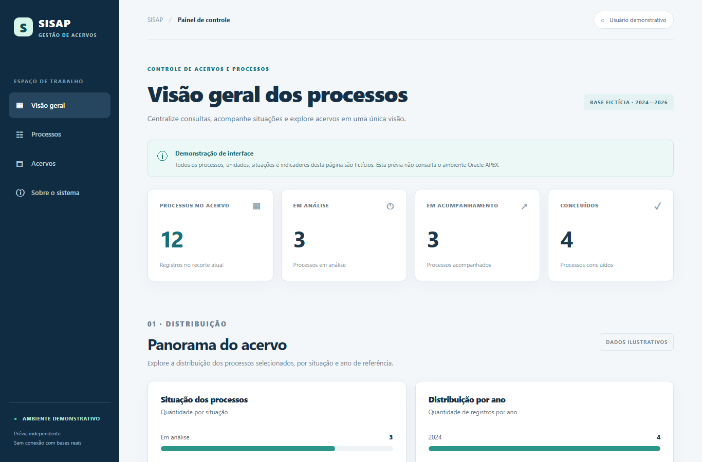
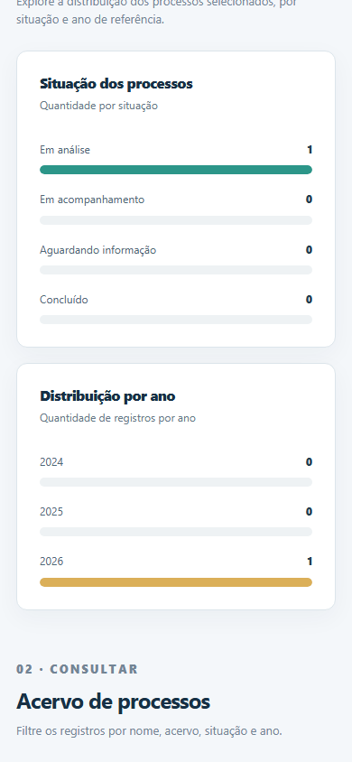

# SISAP — Sistema de Controle do Acervo de Processos

Aplicação para organização de acervos, acompanhamento de processos e consulta de informações relacionadas aos temas de interesse da **SecexAgroAmbiental**, do Tribunal de Contas da União (TCU).

O projeto original foi desenvolvido com **Oracle APEX** e SQL/PLSQL, com páginas para cadastro, consulta e gerenciamento de acervos, processos, temas e macrotemas.

## Interface

O repositório inclui uma **demonstração independente** da experiência de consulta, com dados fictícios e sem conexão com o ambiente institucional.

| Desktop | Celular |
| --- | --- |
|  |  |

## Funcionalidades do SISAP

- **Gestão de acervos:** organização de conjuntos de processos por assunto e área de interesse.
- **Cadastro e consulta de processos:** manutenção e visualização de informações relevantes.
- **Temas e macrotemas:** classificação dos registros para facilitar as consultas.
- **Acompanhamento:** consulta de situações, detalhamentos e registros de interesse.
- **Relatórios e navegação:** páginas Oracle APEX para apresentação e organização das informações.

A estrutura original da aplicação está disponível nas pastas `application/` e `readable/`, com scripts SQL gerados pelo Oracle APEX.

## Experimente a demonstração

A interface demonstrativa permite testar filtros por acervo, situação e ano, visualizar indicadores, buscar processos, abrir detalhes e exportar um recorte em CSV.

**Requisito:** Python 3, apenas para iniciar um servidor HTTP local.

```powershell
git clone https://github.com/JackNoArms/SISAP.git
cd SISAP
python -m http.server 8000
```

Abra **http://localhost:8000/demo/**.

A demonstração usa **12 registros fictícios**, identificados na interface. Ela não representa dados oficiais e não acessa o banco Oracle.

## Tecnologias

| Tecnologia | Aplicação |
| --- | --- |
| **Oracle APEX 23.1** | Aplicação original de gerenciamento de processos |
| **SQL e PL/SQL** | Estruturas, consultas e componentes da aplicação Oracle |
| **HTML, CSS e JavaScript** | Demonstração independente da interface |
| **Node.js Test Runner** | Testes automatizados da demonstração |

## Estrutura

```text
application/    Páginas e componentes da exportação Oracle APEX
readable/       Versão legível de componentes exportados
install.sql     Script de instalação gerado pelo Oracle APEX
demo/           Interface demonstrativa com dados fictícios
tests/          Testes de consistência e filtros da demonstração
docs/           Capturas da interface
```

## Testes da demonstração

Com Node.js 20 ou superior:

```powershell
node --test tests/*.test.mjs
```

Para trabalhar com a aplicação Oracle APEX original, é necessário um ambiente Oracle APEX autorizado, com esquema e dependências adequados. A demonstração web não substitui a aplicação Oracle.

*Projeto apresentado para estudo técnico. Não representa uma publicação oficial do TCU.*
